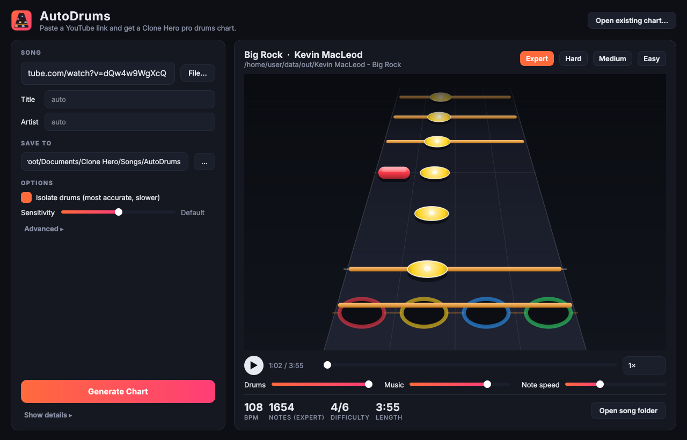

# AutoDrums: automatic Clone Hero pro drums charts

Paste a YouTube link (or pick an audio file), press **Generate Chart**, and AutoDrums writes a
ready-to-play Clone Hero song folder with a **pro drums** chart (toms vs. cymbals) on Expert, Hard,
Medium and Easy. The chart is previewed on a note highway with the song, so you can check it
before you play.



## Download

Windows builds come from GitHub Actions (workflow **Build Windows app**):

* **Installer:** the `AutoDrums-Setup` artifact of the latest successful run (or the *Releases*
  page for tagged versions). It installs per-user and needs no admin rights.
* **Portable:** the `AutoDrums-portable` zip. Unzip it anywhere and run `AutoDrums.exe`.

Everything is bundled: the AI models, ffmpeg, and the YouTube downloader. No Python install is
needed and it works offline (except for downloading from YouTube).

## Using it

1. Paste a YouTube URL (or click **File…** for an mp3/wav/flac/ogg/m4a…).
2. Check **Save to**. It should point at your Clone Hero `Songs` folder (default
   `Documents\Clone Hero\Songs\AutoDrums`).
3. Click **Generate Chart**. A 4-minute song takes about 2–4 minutes with *Isolate drums* on,
   and well under a minute with it off.
4. Preview it with ▶, switch difficulties, mute the music to hear only the drums, or slow
   playback down.
5. In Clone Hero, go to Settings → *Scan songs*. The song appears under the artist name.

Each song folder contains `notes.chart`, `song.ini` (with `pro_drums = True`), `song.ogg`, and,
with *Isolate drums* on, `drums.ogg`, so the drums cut out when you miss, like official charts.
YouTube thumbnails become `album.jpg`.

## How it works

| Step | What happens |
| --- | --- |
| Download | `yt-dlp` fetches the best audio stream (with a bundled JS runtime that YouTube now requires). |
| Isolate drums | **HT-Demucs FT** (drums specialist) separates the drum stem from the mix. |
| Find the beat | **Beat This!** tracks beats and downbeats. Glitches (double/half-time switches, misplaced beats) are repaired. A dynamic program then fits a piecewise-constant tempo, so click-tracked songs get one steady BPM and live recordings get tempo changes only where the timing actually drifts. A Viterbi bar tracker picks the time signatures. The audio is padded so that the chart starts on a bar line with a lead-in. |
| Detect hits | **ADTOF** (a model trained on Rock Band/Clone Hero charts of real songs) detects kick, snare, toms, hi-hat and cymbals, run on both the mix and the isolated drums. |
| Pro drums lanes | Hi-hat becomes the yellow cymbal. Rides (time-keeping patterns) become the blue cymbal and crashes (accents) the green cymbal. Tom hits are pitch-tracked and clustered into high/mid/floor (yellow/blue/green). Impossible chords (three hands, a tom and a cymbal on one lane) are fixed. |
| Quantise | Each beat chooses the subdivision (16ths, triplets, 32nds…) that best explains its hits. |
| Difficulties | Hard, Medium and Easy are reduced from Expert using metric position (downbeats > beats > 8ths > 16ths), spacing and hand limits. |
| Extras | Star power phrases, drum fills (activation lanes) leading into crashes, and practice sections. |

### Accuracy

Measured with the scripts in `tools/` on the MDB Drums dataset (23 real drum recordings, ±50 ms):

| | Kick | Snare | Hi-hat | Ride (blue cym) | Crash (green cym) | Toms |
| --- | --- | --- | --- | --- | --- | --- |
| F-measure | 0.89 | 0.75* | 0.77 | 0.84 | 0.45 | weak |

\*Snare is pulled down by jazz brush ghost notes; on the rock/pop tracks kick, snare and hi-hat are
near perfect. On real songs the tempo map puts notes a median of 3–9 ms from the actual hits.

No automatic charter is perfect. Toms and crash-vs-ride are the hardest calls, so for a
competition-grade chart, open the result in Moonscraper and fix anything that sounds off. The
*Sensitivity* slider trades ghost notes against false hits.

## Options

* **Isolate drums**: on by default. More accurate, and gives the `drums.ogg` stem. Turn it off
  for speed.
* **Sensitivity**: higher picks up quieter hits.
* **Advanced → Browser cookies**: use your browser's YouTube login for age-restricted or
  blocked videos.
* **Advanced → Update YouTube downloader**: fetches the newest yt-dlp if YouTube changes
  something and downloads start failing.

## Troubleshooting

* **"YouTube refused the download" / HTTP 403**: click *Update YouTube downloader*. If it
  still fails, enable *Browser cookies* (Chrome/Edge/Firefox).
* **The chart is slightly early or late**: it shouldn't be, because the audio is re-encoded
  with the chart's offset baked in. Check that Clone Hero's own calibration is set.
* Logs are in `%LOCALAPPDATA%\AutoDrums\autodrums.log`.

## Command line

`autodrums-cli.exe` (next to `AutoDrums.exe`) does the same without the window:

```
autodrums-cli chart "https://www.youtube.com/watch?v=…" -o "D:\Clone Hero\Songs\AutoDrums"
autodrums-cli chart song.mp3 --no-separation --sensitivity 0.6
autodrums-cli selftest
```

## Running from source / building

```
python -m venv venv && venv\Scripts\activate
pip install -r requirements-dev.txt
python -m autodrums            # GUI (models download on first run)
python -m autodrums chart URL  # CLI
python -m pytest tests
```

The Windows build (`.github/workflows/build-windows.yml`) fetches the models
(`tools/fetch_models.py`), ffmpeg and Deno, runs PyInstaller (`packaging/autodrums.spec`),
self-tests the frozen app, and builds the installer with Inno Setup
(`packaging/installer.iss`). Push a tag like `v1.0.0` to publish a release.

## Credits and licences

AutoDrums builds on these projects (details in `THIRD_PARTY_NOTICES.md`):

* **ADTOF** drum transcription, M. Zehren, M. Alunno, P. Bientinesi. Licensed **CC BY-NC-SA 4.0**,
  so AutoDrums builds that bundle it are for **non-commercial use only**.
* **Beat This!**, F. Foscarin, J. Schlüter, G. Widmer (CPJKU). MIT.
* **HT-Demucs**, S. Rouard, F. Massa, A. Défossez (Meta AI). MIT. ONNX export by StemSplit.
* **yt-dlp** (Unlicense), **FFmpeg** (LGPL), **Deno** (MIT), **Qt / PySide6** (LGPL),
  **ONNX Runtime** (MIT).

Only download and chart music you have the right to use.
